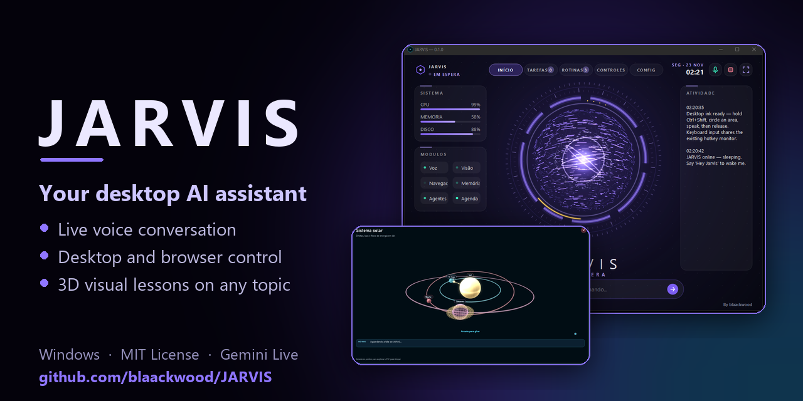
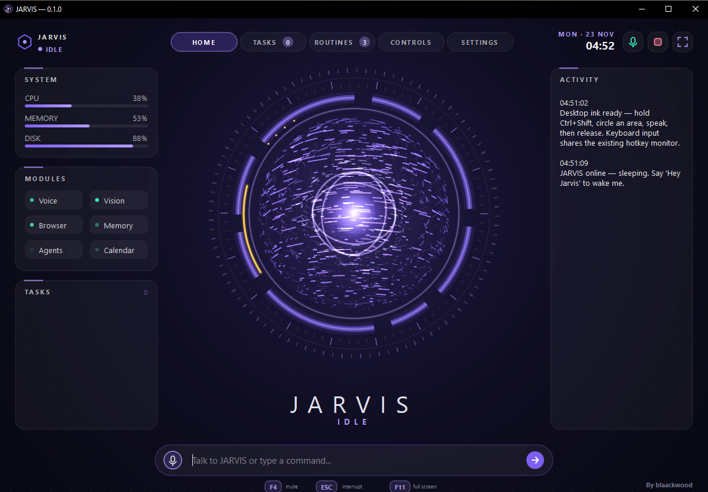
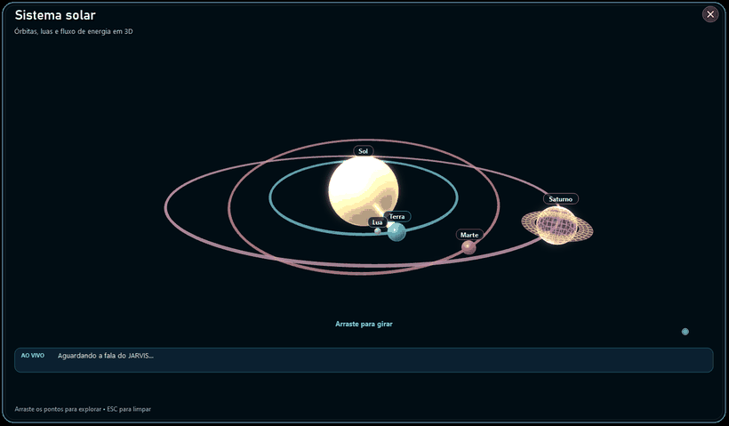
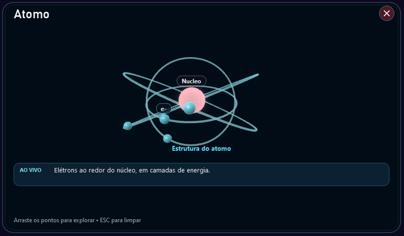

# JARVIS

  

  
  
  
  

<strong>A real JARVIS on your desktop: live voice, computer control and 3D lessons on any topic.</strong>

**Windows 10/11 · 64-bit · v0.1.0**

**[Download the JARVIS Windows installer](https://github.com/blaackwood/JARVIS/releases/latest/download/JARVIS-Setup.exe)** · [All releases](https://github.com/blaackwood/JARVIS/releases) · about 435 MB

Created by [blaackwood](https://github.com/blaackwood).

The Windows installer bundles the application runtime and dependencies.
You **do not need to install Python or Git** to use this release.

> **Windows may show a SmartScreen warning.** The installer is not code-signed yet.
> Download it only from this repository's Releases page, choose
> **More info → Run anyway**, and optionally check the file with
> `Get-FileHash .\JARVIS-Setup.exe -Algorithm SHA256` against the
> `JARVIS-Setup.exe.sha256` file published on the release.

Português: [README.pt-BR.md](README.pt-BR.md)

JARVIS is a desktop assistant with a holographic interface, live voice
conversation, computer and browser control, specialized actions, coding
workflows, persistent memory, scheduled tasks, visual lessons, and optional
remote integrations.

The main conversation engine is Google Gemini Live. Every installation must
use the installing user's own Gemini API key. No developer key, personal
memory, conversation archive, or local account configuration is included.

## See it in action

  

  
  

<em>The 3D lessons above were captured from JARVIS's own visual renderer
(solar system and atom scenes), without audio. Drag to rotate, press ESC to clear.
A demo video with live voice narration will be added.</em>

## Requirements

- Windows 10 or 11, 64-bit.
- Internet access and your own Gemini API key for live voice conversation.
- A microphone and speakers/headphones for voice features.
- The basic holographic avatar is software-rendered and does not require a
  dedicated GPU. Advanced 3D experiences depend on graphics hardware and
  drivers.
- The Chromium Headless Shell used by browser QA is included in the installer.
  Interactive browsing control requires Chrome, Edge, or Firefox installed on
  Windows.
- A validated minimum RAM requirement has not yet been established, so we do
  not publish an unsupported number.

The installer is for Windows x64 only. macOS and Linux users can install from
source using the instructions in INSTALLATION.md.

## Install on Windows

1. Download JARVIS-Setup.exe using the link at the top of this page.
2. Run the installer. It installs JARVIS under your user profile and does not
   require administrator privileges.
3. Launch JARVIS from the shortcut.
4. On first launch, enter and validate your own Gemini API key.

Create or manage your key in
[Google AI Studio](https://aistudio.google.com/apikey). JARVIS unlocks the main
interface only after Google accepts the key.

The installer does not enable wake-word listening or configure JARVIS to start
with Windows. Those options remain under the user's control in app settings.

## What JARVIS can do

- **Talk and listen:** live voice conversations, spoken responses, configurable
  voice and audio devices, push-to-talk, microphone controls, and optional
  local wake-word activation.
- **Control the desktop:** inspect visible applications, interact with
  accessible controls, use mouse/keyboard automation, capture the screen,
  manage windows, and annotate the desktop with visual pointers.
- **Work with files:** open, inspect, search, create, move, copy, rename and
  delete files; process a file explicitly selected or dropped into JARVIS.
- **Browse the web:** navigate websites, search, click, type, scroll, read pages,
  manage tabs, play YouTube media, and look up weather and flight options.
- **Build software:** edit and explain code, create new projects, work on
  existing projects through coding agents, run checks, and use the separate
  JARVIS Agent workbench.
- **Remember and organize work:** local conversation history, semantic memory,
  project context, reminders, recurring routines, focus sessions, and
  background tasks.
- **Teach visually:** holographic 3D scenes, annotated diagrams, guided visual
  lessons, and dedicated chess assistant, coach, and teacher tools.
- **Extend the assistant:** 39 third-party Skills are redistributed with their
  original licences; optional provider, GitHub, Cloudflare, dashboard, and
  desktop-agent integrations are documented separately.

The complete action catalogue is in FEATURES.md. Skill origins and licence
status are in SKILLS.md.

## Security and privacy — quick summary

- JARVIS can interact with files, applications, the mouse, keyboard and browser.
- Sensitive operations use authorization controls and confirmation prompts;
  review an operation before approving it.
- Do not run JARVIS as administrator unless a specific feature genuinely
  requires it.
- Wake-word listening and Windows auto-start are optional and are not enabled
  by the installer.
- JARVIS is not offline-only: voice audio is sent to Gemini; files and screen
  or camera content may be sent to the active provider when you request those
  features.

The key is stored in config/api_keys.json and this version keeps it in plain
text inside your installation. Protect your Windows account and never share
that file. See SECURITY.md for details.

## Optional components

- **Stockfish:** chess features require a separately downloaded Stockfish UCI
  engine. The executable is not bundled in this repository.
- **OpenCode / Codex:** coding-agent workflows require their respective CLI
  installations and user sign-in.
- **Cloudflare reminders:** deploy the optional Worker and D1 database using
  your own Cloudflare account and secrets.
- **Remote dashboard:** pair a phone with the local dashboard from JARVIS
  settings; keep the pairing code private.
- **Local wake word and local speech:** optional model/runtime downloads.
- **Other providers and services:** configure each provider's own key or
  account in JARVIS settings.

## Source installation and development

To install from source, use macOS/Linux, or contribute to the project, see
INSTALLATION.md. This route requires Python 3.11–3.13, Git and dependency setup.

## Licensing and attribution

- Original JARVIS source code is licensed under the MIT License (LICENSE),
  copyright blaackwood.
- Third-party Skills, assets, engines, libraries, and dependencies retain
  their original licences. See THIRD_PARTY_NOTICES.md and SKILLS.md.
- Three Skill entries without an explicit redistribution licence at
  their pinned commit are reference-only and are not copied here.

The JARVIS MIT licence does not relicense any third-party component.

Version history: [CHANGELOG.md](CHANGELOG.md).
