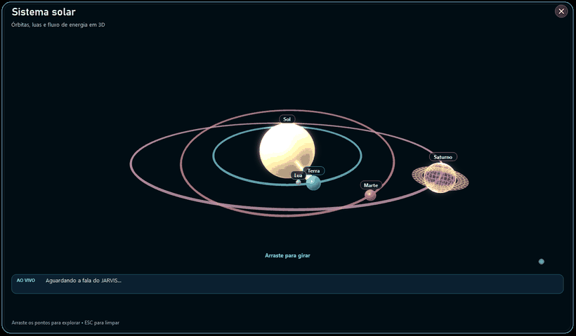
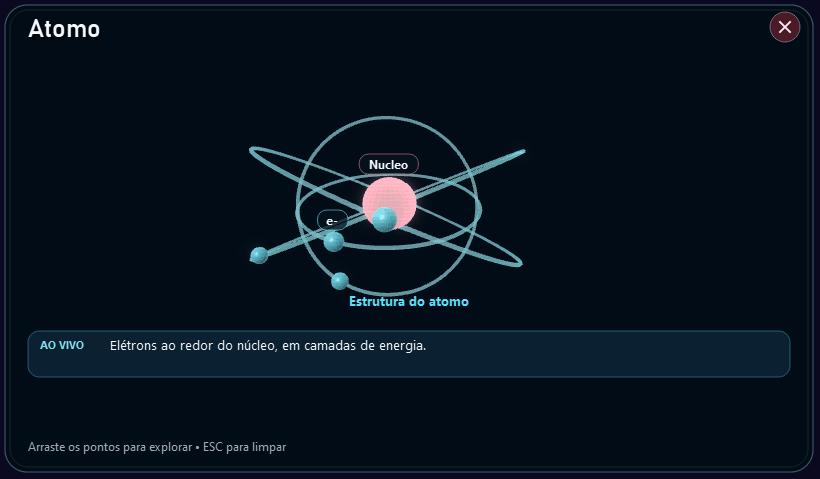
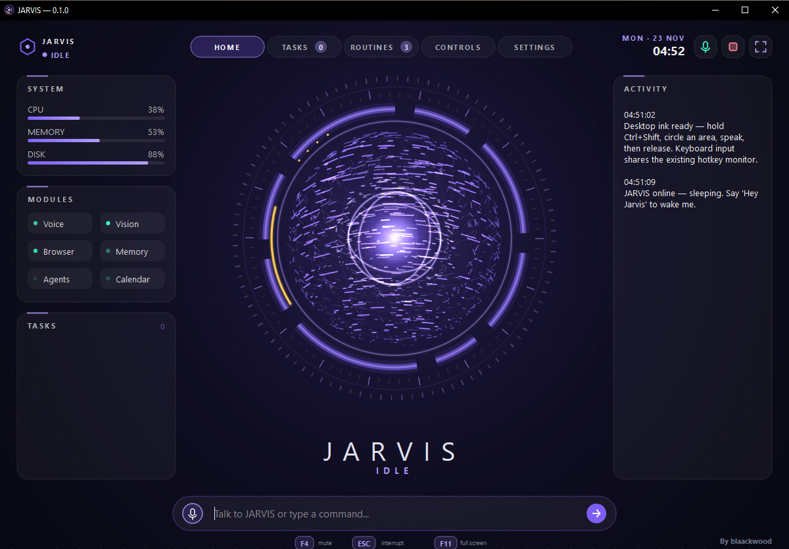
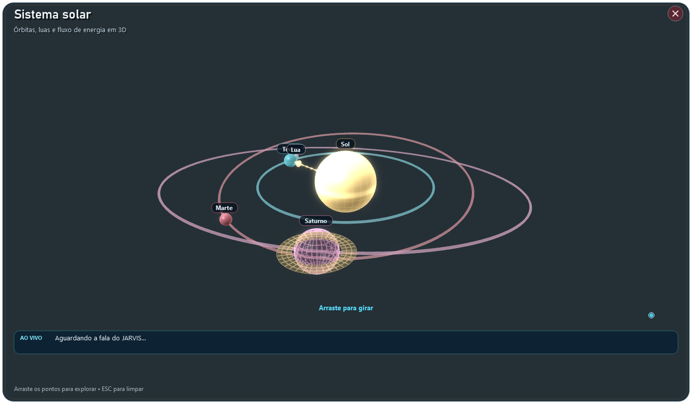
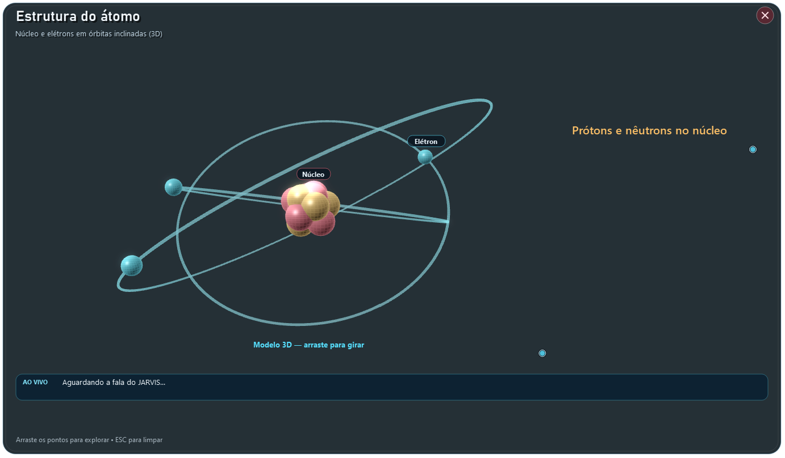

# JARVIS

**Windows 10/11 · 64 bits · v0.1.0**

**[⬇ Baixar instalador do JARVIS](https://github.com/blaackwood/JARVIS/releases/latest/download/JARVIS-Setup.exe)** · [Ver todas as versões](https://github.com/blaackwood/JARVIS/releases)

**Assistente pessoal de desktop criado por blaackwood.**

O instalador para Windows já inclui o runtime e as dependências do aplicativo. Você **não precisa instalar Python ou Git** para usar esta versão.

English: [README.md](README.md)

O JARVIS é um assistente de desktop com interface holográfica, conversa por
voz em tempo real, controle do computador e navegador, ferramentas
especializadas, fluxos de programação, memória persistente, tarefas agendadas,
aulas visuais e integrações remotas opcionais.

O motor principal de conversa é o Google Gemini Live. Cada instalação precisa
ser configurada com a chave de API Gemini do próprio usuário. Nenhuma chave
do desenvolvedor, memória pessoal, histórico de conversas ou configuração
privada da instalação original é distribuída.

## Veja o JARVIS em ação

Os GIFs abaixo mostram capturas curtas do renderizador de aulas 3D do próprio
JARVIS: as cenas do sistema solar e da estrutura do átomo. A interação por voz
aparece separadamente na captura da interface do aplicativo.

  
  

  

  
  

## Requisitos

- Windows 10 ou 11, 64 bits.
- Conexão com a internet e uma chave Gemini própria para a conversa por voz.
- Microfone e alto-falantes/fones para usar voz.
- O avatar holográfico básico é renderizado por software e não exige GPU
  dedicada. O desempenho de experiências 3D avançadas depende do hardware e
  dos drivers gráficos.
- O Chromium Headless Shell usado pelo QA de páginas já vem no instalador.
  Para o controle interativo de navegação, tenha Chrome, Edge ou Firefox
  instalado no Windows.
- Ainda não há um mínimo de RAM oficialmente validado; não queremos publicar
  um número sem testes de compatibilidade que o sustentem.

O instalador é exclusivo para Windows x64. macOS e Linux podem usar a
instalação manual a partir do código-fonte, descrita em INSTALLATION.md.

## Instalação no Windows

1. Baixe JARVIS-Setup.exe pelo link no topo desta página.
2. Execute o instalador. Ele instala o JARVIS na pasta do seu usuário, sem
   exigir privilégios de administrador.
3. Ao terminar, inicie o JARVIS pelo atalho criado.
4. Na primeira abertura, informe sua chave Gemini pessoal e valide-a.

Crie ou gerencie sua chave no
[Google AI Studio](https://aistudio.google.com/apikey). O JARVIS só libera a
interface principal depois que a chave é aceita pelo Google.

O instalador não ativa a escuta por palavra-chave nem configura o JARVIS para
iniciar com o Windows. Essas opções permanecem sob controle do usuário nas
configurações do aplicativo.

## O que o JARVIS faz

- **Voz e conversa:** conversas ao vivo, respostas faladas, seleção de voz e
  dispositivos de áudio, push-to-talk, controle do microfone e ativação
  opcional por palavra-chave local.
- **Controle do computador:** inspeção da janela ativa, interação com
  controles acessíveis, mouse e teclado, captura de tela, gerenciamento de
  janelas e marcações visuais na área de trabalho.
- **Arquivos:** abrir, ler, pesquisar, criar, mover, copiar, renomear e excluir
  arquivos; analisar arquivos selecionados ou arrastados para o JARVIS.
- **Navegação:** abrir e controlar páginas, pesquisar na web, clicar, digitar,
  rolar, ler conteúdo, gerenciar abas e consultar clima e voos.
- **Programação:** explicar, editar e criar código, trabalhar em projetos
  existentes com agentes e executar verificações.
- **Memória e organização:** histórico local de conversas, memória semântica,
  contexto de projetos, lembretes, rotinas, sessões de foco e tarefas em
  segundo plano.
- **Aulas visuais:** cenas holográficas 3D, diagramas, aulas guiadas e três
  ferramentas distintas para xadrez: assistente, treinador e professor.
- **Extensões:** Skills de terceiros com suas próprias licenças, provedores,
  GitHub, Cloudflare, painel remoto e agente desktop.

A lista completa das ferramentas está em FEATURES.md. A origem e a licença
de cada Skill estão em SKILLS.md.

## Segurança e privacidade — resumo

- O JARVIS pode interagir com arquivos, aplicativos, mouse, teclado e navegador.
- Ações sensíveis usam controles de autorização e prompts de confirmação;
  revise uma operação antes de aprová-la.
- Não execute o JARVIS como administrador, a menos que uma função específica
  realmente exija isso.
- A escuta por palavra-chave e a inicialização automática são opcionais e
  não são ativadas pelo instalador.
- O JARVIS não é totalmente offline: áudio da conversa é enviado ao Gemini;
  arquivos e conteúdo de tela/câmera podem ser enviados ao provedor quando
  você solicita essas funções.

A chave fica em config/api_keys.json e, nesta versão, é armazenada em texto
simples dentro da sua instalação. Proteja sua conta do Windows e nunca envie
esse arquivo a issues, fóruns ou outras pessoas. Consulte SECURITY.md para
mais detalhes.

## Recursos opcionais

Alguns recursos precisam de configuração independente: Stockfish para xadrez,
OpenCode/Codex para agentes de programação, conta Cloudflare para lembretes
remotos, pareamento do painel remoto, modelos locais de voz e credenciais
específicas de outros provedores. A chave Gemini não substitui essas
configurações.

## Instalação manual e desenvolvimento

Para instalar a partir do código-fonte, usar macOS/Linux ou contribuir com o
projeto, consulte INSTALLATION.md. Essa modalidade requer Python 3.11–3.13,
Git e instalação das dependências.

## Licença e autoria

O código original do JARVIS está sob a licença MIT (LICENSE), copyright
blaackwood. Skills, bibliotecas, ferramentas, motores e ativos de terceiros
mantêm suas próprias licenças e titulares. Consulte
THIRD_PARTY_NOTICES.md e SKILLS.md.

A licença MIT do JARVIS não altera nem substitui as licenças de terceiros.

Histórico de versões: [CHANGELOG.md](CHANGELOG.md).
